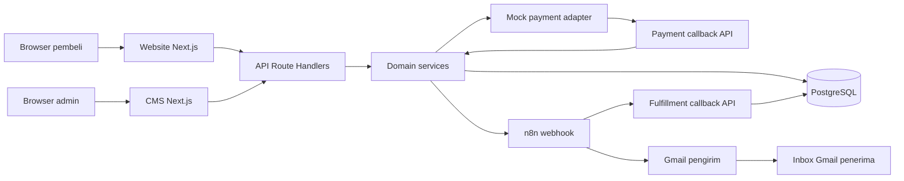
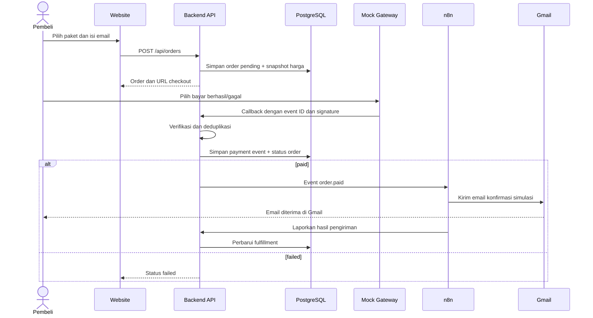

# Implementation & Technical Architecture (ITA)

## 1. Tujuan dan status

Dokumen ini menerjemahkan [BRD.md](BRD.md) dan [PEP.md](PEP.md) menjadi rancangan teknis untuk **Travel eSIM Ordering & Fulfillment Demo**. Rancangan ditujukan untuk technical test Fullstack Developer JavaMifi dengan tenggat **28 Oktober 2026 pukul 23.59 WIB**.

**Status:** rancangan; belum ada aplikasi yang diimplementasikan atau email yang telah dikirim. Pembayaran dan kode eSIM adalah simulasi. Email konfirmasi ditargetkan benar-benar diterima di Gmail setelah kredensial pengirim dikonfigurasi dan alur diuji.

## 2. Prinsip arsitektur

1. Satu repository dan satu aplikasi Next.js untuk mempercepat pengerjaan, dengan modul internal yang memiliki tanggung jawab jelas.
2. Website dan CMS mengonsumsi API internal yang sama untuk operasi bisnis utama.
3. Harga, status pesanan, dan otorisasi ditentukan di server; browser tidak dipercaya sebagai sumber kebenaran.
4. Pembayaran dipisahkan melalui antarmuka adaptor sehingga mock gateway dapat diganti sandbox tanpa mengubah logika pesanan.
5. n8n mengurus automasi setelah pembayaran; kegagalan email tidak membatalkan status pembayaran `paid`.
6. Integrasi memakai ID/event unik agar callback berulang tidak membuat pesanan atau email ganda dalam kondisi normal.

## 3. Komponen dan teknologi

| Komponen | Teknologi/pendekatan | Tanggung jawab |
| --- | --- | --- |
| UI publik | Next.js App Router + TypeScript | Katalog, detail paket, checkout, status pesanan. |
| UI admin | Next.js App Router + TypeScript | Login, pengelolaan paket, pemantauan pesanan. |
| API | Next.js Route Handlers | Endpoint publik/admin, payment callback, dan callback n8n. |
| Domain services | Modul TypeScript di server | Aturan katalog, harga, order, payment, fulfillment. |
| Data access | Prisma ORM + PostgreSQL | Model data, query, migrasi, transaksi. |
| Mock payment | Modul gateway + halaman checkout simulasi | Sesi pembayaran dan hasil sukses/gagal. |
| Automation | n8n sebagai layanan terpisah | Webhook pembayaran, kirim email, lapor hasil. |
| Email | Send Email node n8n dengan credential SMTP Resend | Mengirim email nyata ke alamat Gmail pembeli/penguji. |

Dokumentasi acuan: [Next.js Route Handlers](https://nextjs.org/docs/app/getting-started/route-handlers), [Prisma ORM](https://www.prisma.io/docs/orm), [n8n Webhook node](https://docs.n8n.io/integrations/builtin/core-nodes/n8n-nodes-base.webhook/), dan [n8n Send Email](https://docs.n8n.io/integrations/builtin/core-nodes/n8n-nodes-base.sendemail/).

### Diagram komponen



## 4. Batas modul yang diusulkan

```text
src/
  app/
    (public)/             # katalog, checkout, status
    admin/                # UI CMS
    mock-payment/         # UI checkout simulasi
    api/                  # route handlers tipis
  modules/
    catalog/              # query paket dan aturan publikasi
    orders/               # pembuatan order, snapshot harga
    payments/             # kontrak provider, mock, callback
    fulfillment/          # event, status konfirmasi, n8n
    auth/                 # login/session admin
  db/                     # Prisma client dan repository
  shared/                 # schema validasi, error, utilitas umum
prisma/                   # schema dan migrasi
n8n/                      # ekspor workflow tanpa credential
```

Route handler hanya menerima request, memvalidasi input, memanggil service, dan memetakan response. Aturan bisnis tidak ditaruh langsung di komponen UI atau route handler.

## 5. Model data logis

| Entitas | Field inti | Aturan |
| --- | --- | --- |
| `Destination` | `id`, `code`, `name`, `isActive` | `code` unik. |
| `Plan` | `id`, `destinationId`, `name`, `quota`, `validityDays`, `priceIdr`, `isActive` | Harga integer rupiah; hanya paket aktif dapat dipesan. |
| `Admin` | `id`, `email`, `passwordHash` | Email unik; password tidak disimpan dalam bentuk asli. |
| `Order` | `id`, `publicCode`, `buyerEmail`, `planId`, `planSnapshot`, `amountIdr`, `paymentStatus`, `createdAt` | `publicCode` tidak mudah ditebak; snapshot menjaga harga historis. |
| `PaymentSession` | `id`, `orderId`, `tokenHash`, `status`, `expiresAt` | Token checkout dibatasi waktu dan digunakan untuk satu hasil final. |
| `PaymentEvent` | `id`, `providerEventId`, `orderId`, `result`, `receivedAt` | `providerEventId` unik untuk deduplikasi. |
| `Fulfillment` | `id`, `orderId`, `status`, `n8nExecutionId`, `emailMessageId`, `error`, `updatedAt` | Satu record per order; hanya dibuat untuk order `paid`. |

Status payment: `pending → paid` atau `pending → failed`. Status fulfillment: `pending → processing → sent` atau `pending/processing → error`. Perubahan status dilakukan dalam transaksi database ketika perlu menjaga konsistensi antara order dan event.

## 6. Kontrak API awal

| Method dan path | Akses | Fungsi |
| --- | --- | --- |
| `GET /api/destinations` | Publik | Daftar destinasi aktif. |
| `GET /api/plans?destination=...` | Publik | Daftar paket aktif. |
| `GET /api/plans/:id` | Publik | Detail paket aktif. |
| `POST /api/orders` | Publik | Validasi email/paket, hitung harga server, buat order `pending`. |
| `GET /api/orders/:publicCode` | Pemegang kode | Status ringkas order tanpa data sensitif berlebih. |
| `POST /api/orders/:publicCode/payment-session` | Pemegang kode | Buat URL checkout mock. |
| `POST /api/mock-payment/:sessionId/complete` | Pemegang token sesi | Pilih hasil simulasi; mock gateway membuat callback server ke server. |
| `POST /api/payment/webhook` | Mock gateway | Verifikasi signature dan event ID; perbarui status secara idempoten. |
| `POST /api/admin/login` | Publik | Login admin dan buat session cookie. |
| `POST /api/admin/logout` | Admin | Akhiri sesi. |
| `GET/POST/PATCH /api/admin/plans` | Admin | Kelola paket. Implementasi route detail dapat dipisah per ID. |
| `GET /api/admin/orders` | Admin | Daftar dan detail pesanan. |
| `POST /api/internal/fulfillment-result` | n8n | Verifikasi secret; catat hasil email. |

Semua endpoint mutasi memakai validasi server. API admin memeriksa sesi di server. Endpoint internal memakai secret terpisah. Respons error memakai format konsisten (`code`, `message`) tanpa membocorkan secret atau stack trace.

## 7. Alur pembayaran dan automasi



### Proteksi callback dan pengulangan

- Mock gateway menandatangani callback dengan secret bersama; backend menghitung ulang signature sebelum menerima event.
- `providerEventId` unik dan status order final mencegah callback yang sama diproses dua kali.
- Dalam satu transaksi, callback sukses mengubah order ke `paid` dan membuat satu fulfillment `pending` dengan `orderId` unik.
- Pengiriman event ke n8n dilakukan setelah transaksi berhasil. Jika n8n sementara gagal, fulfillment tetap terlihat sebagai `pending/error` untuk dicoba ulang secara terkendali.
- Pengiriman email tidak memiliki jaminan mutlak *exactly once* saat terjadi kegagalan jaringan setelah relay menerima pesan tetapi sebelum n8n melaporkan hasil. Untuk demo, callback berulang tidak boleh mengirim ulang email; kasus hasil kirim yang tidak pasti perlu ditandai untuk pemeriksaan admin sebelum retry.

## 8. Autentikasi, keamanan, dan privasi

- Admin memakai sesi berbasis cookie `HttpOnly`, `Secure` ketika HTTPS, dan `SameSite` yang sesuai. Password disimpan dengan hash adaptif.
- Akun admin dibuat melalui seed/config awal; tidak ada registrasi admin publik.
- Endpoint payment memakai secret HMAC; callback n8n ke backend memakai token unik per order. Secret, database URL, dan credential Resend hanya ada di environment/n8n credential store, bukan Git. Port n8n pada Compose dibatasi ke loopback.
- Harga dihitung ulang di backend. Browser hanya mengirim ID paket dan email; total dari browser diabaikan.
- Token/URL untuk status order harus sulit ditebak. Respons publik hanya menampilkan data yang diperlukan.
- Email penerima berasal dari order tervalidasi. Isi email menyatakan bahwa kode eSIM adalah contoh dan tidak dapat digunakan untuk aktivasi.
- Log aplikasi menyimpan ID referensi dan status, bukan password, token, atau isi credential.

## 9. Lingkungan dan konfigurasi

| Layanan | Lokal | Catatan |
| --- | --- | --- |
| Next.js | Proses aplikasi | Memerlukan `DATABASE_URL`, secret sesi, secret payment, dan URL n8n. |
| PostgreSQL | Container atau instalasi lokal | Migrasi dan seed harus terdokumentasi. |
| n8n | Container atau instance yang tersedia | Workflow diimpor dari `n8n/`; URL webhook aktif dan credential Resend dikonfigurasi manual. |
| Resend dan Gmail | Layanan pengirim + inbox penerima | SMTP Resend dihubungkan melalui credential n8n dengan API key; email nyata diuji di Gmail sebelum submission. |

Sediakan `.env.example` tanpa nilai rahasia dan `README.md` yang menjelaskan perbedaan URL antar-container dan dari browser bila menggunakan Docker Compose. File ekspor n8n tidak boleh mengandung credential.

## 10. Verifikasi arsitektur dan penerimaan

| Pemeriksaan | Bukti |
| --- | --- |
| API connection | Website/CMS memakai endpoint internal dan data tersimpan. |
| CMS | Admin membuat/mengubah/nonaktifkan paket; katalog berubah. |
| Payment sukses | Callback valid membuat order `paid` dan satu fulfillment. |
| Payment gagal | Order `failed`; tidak ada event konfirmasi sukses. |
| Callback ulang | Satu payment event diproses; satu fulfillment; tidak ada email kedua. |
| n8n dan Gmail | Eksekusi workflow sukses dan email ada di inbox Gmail penerima. |
| Keamanan dasar | Admin API menolak tanpa sesi; callback tidak sah ditolak; harga tidak dapat dimanipulasi dari browser. |
| Reproduksi | README, migrasi, seed, workflow export, dan langkah demo bekerja dari checkout bersih. |

## 11. Batas dan keputusan lanjutan

- Tidak ada integrasi sistem JavaMifi, operator eSIM, atau transaksi uang sungguhan.
- URL deployment publik tidak diminta HR; aplikasi lokal yang dapat dijalankan dari repository menjadi target wajib.
- Provider email pengirim memerlukan akun dan credential yang tersedia pada saat integrasi. Tanpa itu, target email Gmail belum dapat diverifikasi dan tidak boleh dinyatakan selesai.
- Rancangan endpoint dan struktur folder dapat disesuaikan saat implementasi, selama kontrak bisnis dan bukti penerimaan tetap terpenuhi.
