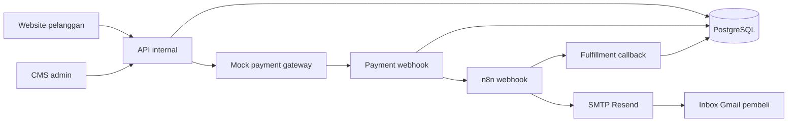

# TripConnect — Travel eSIM Technical Test

Demo fullstack pemesanan travel eSIM yang terinspirasi oleh domain bisnis JavaMifi. Aplikasi ini **bukan produk resmi JavaMifi**. Pembayaran dan kode aktivasi eSIM bersifat simulasi; email konfirmasi dikirim sungguhan melalui workflow n8n setelah layanan pengirim dikonfigurasi.

## Fitur

- Website publik: katalog paket, filter destinasi, detail, checkout, dan status pesanan.
- CMS admin: login, tambah/ubah/nonaktifkan destinasi dan paket, daftar pesanan, status pembayaran dan email.
- API internal untuk katalog, pesanan, CMS, payment callback, dan fulfillment callback.
- Mock payment gateway dengan halaman pembayaran, hasil sukses/gagal, signature callback, dan penanganan callback berulang.
- Workflow n8n: menerima event `order.paid`, mengirim email lewat SMTP, lalu mencatat hasilnya di aplikasi.

## Stack dan arsitektur

| Komponen | Teknologi |
| --- | --- |
| Frontend dan CMS | Next.js App Router, React, TypeScript |
| Backend/API | Next.js Route Handlers, modul layanan TypeScript |
| Data | PostgreSQL, Prisma ORM |
| Payment | Mock gateway lokal |
| Automation | n8n |
| Email | SMTP Resend melalui n8n (API key disimpan di credential n8n) |



Kode dipisah di `src/app` (UI dan API), `src/modules` (logika bisnis/integrasi), `src/lib` (database, auth, validasi), `prisma` (model/migrasi/seed), serta `n8n` (workflow ekspor). Rancangan lebih rinci ada di [ITA.md](ITA.md).

## Prasyarat

- Node.js 24 atau versi kompatibel dengan Next.js 16.
- npm.
- Docker Desktop dengan Compose untuk PostgreSQL dan n8n.
- Untuk **email nyata ke Gmail**: akun Resend dan API key dengan izin *Sending access*. Pada mode uji `onboarding@resend.dev`, gunakan alamat Gmail pemilik akun Resend sebagai penerima. Jika credential belum tersedia, alur payment tetap berjalan dan CMS akan menunjukkan status email `ERROR`.

## Instalasi dan menjalankan

1. Salin `.env.example` menjadi `.env` dan isi `SESSION_SECRET`, `PAYMENT_WEBHOOK_SECRET`, `ADMIN_EMAIL`, `ADMIN_PASSWORD`, serta `MAIL_FROM` dengan nilai milik Anda. Gunakan secret acak panjang dan jangan commit `.env`.
2. Instal dependensi dan jalankan layanan:

   ```powershell
   npm install
   docker compose up -d
   ```

3. Siapkan database dan data contoh:

   ```powershell
   npx prisma migrate deploy
   npm run db:seed
   ```

4. Jalankan aplikasi:

   ```powershell
   npm run dev
   ```

5. Buka website di `http://localhost:3000`, CMS di `http://localhost:3000/admin`, dan n8n di `http://localhost:5678`. Login CMS dengan `ADMIN_EMAIL` dan `ADMIN_PASSWORD` dari `.env`.

`APP_URL` adalah alamat aplikasi yang bisa dipanggil proses Next.js. Pada setup Docker Desktop lokal, `N8N_WEBHOOK_URL=http://localhost:5678/webhook/order-paid` dan `N8N_CALLBACK_BASE_URL=http://host.docker.internal:3000` memungkinkan n8n di container memanggil API aplikasi di host.

## Menyiapkan n8n dan email Gmail

1. Buka `http://localhost:5678` dan buat akun owner lokal n8n pada kunjungan pertama.
2. Impor [n8n/tripconnect-order-paid.json](n8n/tripconnect-order-paid.json) melalui menu import workflow. Workflow ini berisi **Webhook → Send Gmail Confirmation (SMTP) → Report Email Result / Report Email Error**.
3. Buat akun Resend dengan Gmail penerima demo. Di dashboard Resend, buat API key dengan izin **Sending access**. Pada node **Send Gmail Confirmation**, buat credential **SMTP account** sesuai [panduan SMTP Resend](https://resend.com/changelog/smtp-service): User `resend`, Host `smtp.resend.com`, Port `465`, SSL/TLS aktif, dan Password adalah API key Resend. Nilai `MAIL_FROM` di `.env` adalah `onboarding@resend.dev`. **Masukkan API key hanya di n8n**, bukan di repository atau chat.
4. Simpan dan aktifkan workflow. URL production webhook harus sesuai `N8N_WEBHOOK_URL`.
5. Buat pesanan menggunakan alamat Gmail penerima yang dapat Anda cek. Pilih **Simulasikan sukses**. Pastikan order `PAID`, fulfillment `SENT`, eksekusi n8n sukses, dan pesan muncul di inbox Gmail (periksa Spam bila perlu).

Pada instance lokal pengembangan, workflow aktif dan credential SMTP Resend sudah terhubung. Satu order pembayaran sukses telah menghasilkan status `PAID`/`SENT`, dan pesan konfirmasi diterima di Inbox Gmail penguji pada 27 Oktober 2026. Credential hanya tersimpan pada volume n8n lokal; reviewer tetap perlu mengonfigurasi credential sendiri setelah mengimpor workflow.

## Skenario demo untuk reviewer

1. Login ke CMS, ubah salah satu harga paket, lalu buka ulang katalog publik untuk melihat perubahan.
2. Buat pesanan dengan email penguji, pilih pembayaran **sukses**, lalu periksa status `PAID`, eksekusi n8n, dan email konfirmasi.
3. Buat pesanan kedua, pilih pembayaran **gagal**; status menjadi `FAILED` dan tidak ada email sukses.
4. Ulangi request pembayaran pada sesi yang sudah final; status tidak berubah dan tidak ada pengiriman kedua.

Harga order disalin saat checkout sehingga perubahan harga paket di CMS tidak mengubah order lama. Callback payment memakai HMAC signature dan event ID unik. Status order diubah dengan kondisi `PENDING`, sehingga callback berulang tidak menciptakan fulfillment kedua. Jika email gagal, status pembayaran tetap `PAID`; status fulfillment berubah menjadi `ERROR` dan terlihat di CMS.

## Endpoint utama

| Method | Endpoint | Fungsi |
| --- | --- | --- |
| GET | `/api/destinations`, `/api/plans`, `/api/plans/:id` | Katalog publik |
| POST | `/api/orders` | Buat order dan sesi pembayaran |
| GET | `/api/orders/:code` | Status order publik |
| GET/POST | `/api/payment/session/:token` | Detail sesi dan hasil mock payment |
| POST | `/api/payment/webhook` | Callback bertanda tangan |
| POST | `/api/admin/login`, `/api/admin/logout` | Autentikasi CMS |
| GET/POST/PATCH | `/api/admin/destinations` dan `/api/admin/destinations/:id` | Kelola destinasi |
| GET/POST/PATCH | `/api/admin/plans` dan `/api/admin/plans/:id` | Kelola paket |
| GET | `/api/admin/orders` | Pantau order |
| POST | `/api/internal/fulfillment-result` | Hasil email dari n8n |

## Pemeriksaan kualitas

```powershell
npm run build
npm run lint
```

Pengujian manual utama: paket aktif/nonaktif, login admin, payment sukses/gagal, callback berulang, dan status email. Workflow email nyata memerlukan credential SMTP yang dikonfigurasi secara lokal; file ekspor workflow tidak memuat secret.

## Batas demo

- Tidak terhubung ke API atau sistem internal JavaMifi.
- Tidak memproses uang atau menerbitkan eSIM aktif.
- Payment gateway adalah mock lokal yang sengaja memperlihatkan pola sesi, callback, verifikasi, dan idempotensi.
- Port database dan n8n pada Compose hanya terbuka di `127.0.0.1`. Jika n8n dipublikasikan, tambahkan autentikasi pada webhook masuk sebelum mengeksposnya ke internet.
- Tidak ada URL deployment publik; reviewer dapat menjalankannya dari repository dengan langkah di atas.
