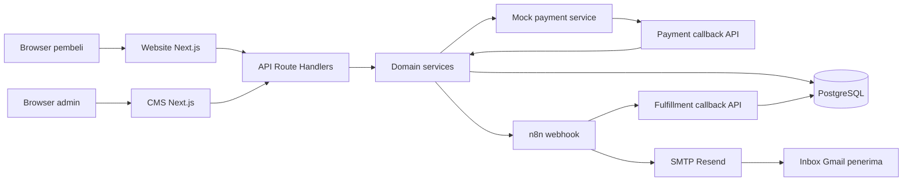
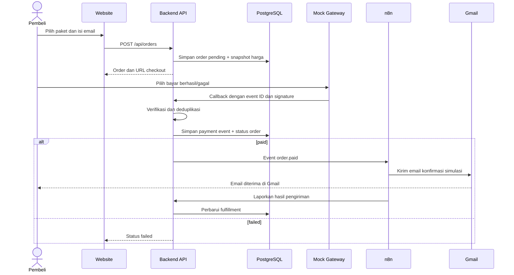

# Implementation & Technical Architecture (ITA)

## 1. Tujuan dan status

Dokumen ini menjelaskan implementasi teknis **Travel eSIM Ordering & Fulfillment Demo** berdasarkan [BRD.md](BRD.md) dan [PEP.md](PEP.md). Proyek ditujukan untuk technical test Fullstack Developer JavaMifi dengan tenggat **28 Oktober 2026 pukul 23.59 WIB**.

**Status:** MVP telah diimplementasikan. Pembayaran dan kode eSIM adalah simulasi; email konfirmasi nyata telah diterima di Gmail penguji pada 27 Oktober 2026. Hasil pengujian dicatat di [QA-TEST.md](QA-TEST.md).

## 2. Prinsip arsitektur

1. Satu repository dan satu aplikasi Next.js untuk mempercepat pengerjaan, dengan modul internal yang memiliki tanggung jawab jelas.
2. Website dan CMS mengonsumsi API internal yang sama untuk operasi bisnis utama.
3. Harga, status pesanan, dan otorisasi ditentukan di server; browser tidak dipercaya sebagai sumber kebenaran.
4. Logika callback pembayaran dan pengiriman ke n8n berada di modul layanan terpisah dari UI.
5. n8n mengurus automasi setelah pembayaran; kegagalan email tidak membatalkan status pembayaran `paid`.
6. Integrasi memakai ID/event unik agar callback berulang tidak membuat pesanan atau email ganda dalam kondisi normal.

## 3. Komponen dan teknologi

| Komponen | Teknologi/pendekatan | Tanggung jawab |
| --- | --- | --- |
| UI publik | Next.js App Router + TypeScript | Katalog, detail paket, checkout, status pesanan. |
| UI admin | Next.js App Router + TypeScript | Login, pengelolaan paket, pemantauan pesanan. |
| API | Next.js Route Handlers | Endpoint publik/admin, payment callback, dan callback n8n. |
| Layanan bisnis | Modul TypeScript di server | Pemrosesan callback payment dan dispatch fulfillment. Aturan katalog/order berada di route handler terkait. |
| Data access | Prisma ORM + PostgreSQL | Model data, query, migrasi, transaksi. |
| Mock payment | Halaman checkout dan endpoint sesi lokal | Sesi pembayaran serta hasil sukses/gagal yang dikirim sebagai callback bertanda tangan. |
| Automation | n8n sebagai layanan terpisah | Webhook pembayaran, kirim email, lapor hasil. |
| Email | Send Email node n8n dengan credential SMTP Resend | Mengirim email nyata ke alamat Gmail pembeli/penguji. |

Dokumentasi acuan: [Next.js Route Handlers](https://nextjs.org/docs/app/getting-started/route-handlers), [Prisma ORM](https://www.prisma.io/docs/orm), [n8n Webhook node](https://docs.n8n.io/integrations/builtin/core-nodes/n8n-nodes-base.webhook/), dan [n8n Send Email](https://docs.n8n.io/integrations/builtin/core-nodes/n8n-nodes-base.sendemail/).

### Diagram komponen



## 4. Struktur modul aktual

```text
src/
  app/                    # halaman publik, halaman CMS, dan API Route Handlers
    admin/                # UI CMS
    plans/[id]/           # detail paket dan formulir pemesanan
    pay/[token]/          # checkout mock
    orders/[code]/        # status pesanan
    api/                  # endpoint publik, admin, payment, dan callback n8n
  modules/
    payments/service.ts   # verifikasi dan pemrosesan callback payment
    fulfillment/service.ts # dispatch event pembayaran sukses ke n8n
  lib/                    # Prisma client, autentikasi, validasi, utilitas
prisma/                   # schema, migrasi, seed
n8n/                      # ekspor workflow tanpa credential
```

Route handler katalog, order, dan admin memuat query serta validasi yang dekat dengan endpoint. Proses payment dan fulfillment yang memiliki alur lintas layanan dipisahkan di `src/modules/`. Harga order selalu diambil dari database di server.

## 5. Model data logis

| Entitas | Field inti | Aturan |
| --- | --- | --- |
| `Destination` | `id`, `code`, `name`, `isActive` | `code` unik. |
| `Plan` | `id`, `destinationId`, `name`, `quotaGb`, `validityDays`, `priceIdr`, `isActive` | Harga integer rupiah; hanya paket dan destinasi aktif dapat dipesan. |
| `Admin` | `id`, `email`, `passwordHash` | Email unik; password tidak disimpan dalam bentuk asli. |
| `Order` | `id`, `publicCode`, `buyerEmail`, `planId`, `planName`, `destinationName`, `quotaGb`, `validityDays`, `amountIdr`, `paymentStatus` | Salinan detail paket dan harga menjaga data historis. |
| `PaymentSession` | `id`, `orderId`, `tokenHash`, `expiresAt` | Token checkout disimpan sebagai hash dan dibatasi waktu. |
| `PaymentEvent` | `id`, `providerEventId`, `orderId`, `status`, `createdAt` | `providerEventId` unik untuk deduplikasi. |
| `Fulfillment` | `id`, `orderId`, `status`, `callbackToken`, `emailMessageId`, `error`, `updatedAt` | Satu record per order `paid`; token callback disimpan sebagai hash. |

Status payment: `pending → paid` atau `pending → failed`. Status fulfillment: `pending → processing → sent` atau `pending/processing → error`. Perubahan status dilakukan dalam transaksi database ketika perlu menjaga konsistensi antara order dan event.

## 6. Endpoint yang diimplementasikan

| Method dan path | Akses | Fungsi |
| --- | --- | --- |
| `GET /api/destinations` | Publik | Daftar destinasi aktif. |
| `GET /api/plans?destination=...` | Publik | Daftar paket aktif. |
| `GET /api/plans/:id` | Publik | Detail paket aktif. |
| `POST /api/orders` | Publik | Validasi email/paket, hitung harga server, buat order `pending`. |
| `GET /api/orders/:publicCode` | Pemegang kode | Status ringkas order tanpa data sensitif berlebih. |
| `GET/POST /api/payment/session/:token` | Pemegang token sesi | Baca sesi atau pilih hasil simulasi; endpoint mengirim callback bertanda tangan. |
| `POST /api/payment/webhook` | Mock gateway | Verifikasi signature dan event ID; perbarui status secara idempoten. |
| `POST /api/admin/login` | Publik | Login admin dan buat session cookie. |
| `POST /api/admin/logout` | Admin | Akhiri sesi. |
| `GET/POST /api/admin/plans`, `PATCH /api/admin/plans/:id` | Admin | Kelola paket. |
| `GET/POST /api/admin/destinations`, `PATCH /api/admin/destinations/:id` | Admin | Kelola destinasi. |
| `GET /api/admin/orders` | Admin | Daftar dan detail pesanan. |
| `POST /api/internal/fulfillment-result` | n8n | Verifikasi secret; catat hasil email. |

Semua endpoint mutasi memakai validasi server. API admin memeriksa sesi di server. Endpoint internal memakai secret terpisah. Respons error memakai format konsisten (`code`, `message`) tanpa membocorkan secret atau stack trace.

## 7. Alur pembayaran dan automasi



### Proteksi callback dan pengulangan

- Mock gateway menandatangani callback dengan secret bersama; backend menghitung ulang signature sebelum menerima event.
- `providerEventId` unik dan status order final mencegah callback yang sama diproses dua kali.
- Dalam satu transaksi, callback sukses mengubah order ke `paid` dan membuat satu fulfillment `pending` dengan `orderId` unik.
- Pengiriman event ke n8n dilakukan setelah transaksi berhasil. Jika n8n gagal, payment tetap `PAID` dan fulfillment terlihat `ERROR` di CMS. Demo ini tidak menyediakan tombol retry email.
- Callback payment berulang tidak mengirim ulang email. Pengiriman email tidak memiliki jaminan mutlak *exactly once* saat hasil dari layanan SMTP tidak pasti.

## 8. Autentikasi, keamanan, dan privasi

- Admin memakai sesi berbasis cookie `HttpOnly`, `Secure` ketika HTTPS, dan `SameSite` yang sesuai. Password disimpan dengan hash adaptif.
- Akun admin dibuat melalui seed/config awal; tidak ada registrasi admin publik.
- Endpoint payment memakai secret HMAC; callback n8n ke backend memakai token unik per order. Secret, database URL, dan credential Resend hanya ada di environment/n8n credential store, bukan Git. Port n8n pada Compose dibatasi ke loopback.
- Harga dihitung ulang di backend. Browser hanya mengirim ID paket dan email; total dari browser diabaikan.
- Token/URL untuk status order harus sulit ditebak. Respons publik hanya menampilkan data yang diperlukan.
- Email penerima berasal dari order tervalidasi. Isi email menyatakan bahwa kode eSIM adalah contoh dan tidak dapat digunakan untuk aktivasi.
- Log aplikasi menyimpan ID referensi dan status, bukan password, token, atau isi credential.

## 9. Lingkungan dan konfigurasi

| Layanan | Lokal | Catatan |
| --- | --- | --- |
| Next.js | Proses aplikasi | Memerlukan `DATABASE_URL`, secret sesi, secret payment, dan URL n8n. |
| PostgreSQL | Container atau instalasi lokal | Migrasi dan seed harus terdokumentasi. |
| n8n | Container atau instance yang tersedia | Workflow diimpor dari `n8n/`; URL webhook aktif dan credential Resend dikonfigurasi manual. |
| Resend dan Gmail | Layanan pengirim + inbox penerima | SMTP Resend dihubungkan melalui credential n8n dengan API key; email nyata diuji di Gmail sebelum submission. |

Sediakan `.env.example` tanpa nilai rahasia dan `README.md` yang menjelaskan perbedaan URL antar-container dan dari browser bila menggunakan Docker Compose. File ekspor n8n tidak boleh mengandung credential.

## 10. Verifikasi arsitektur dan penerimaan

| Pemeriksaan | Bukti |
| --- | --- |
| API connection | Website/CMS memakai endpoint internal dan data tersimpan. |
| CMS | Admin membuat/mengubah/nonaktifkan paket; katalog berubah. |
| Payment sukses | Callback valid membuat order `paid` dan satu fulfillment. |
| Payment gagal | Order `failed`; tidak ada event konfirmasi sukses. |
| Callback ulang | Satu payment event diproses; satu fulfillment; tidak ada email kedua. |
| n8n dan Gmail | Eksekusi workflow sukses dan email ada di inbox Gmail penerima. |
| Keamanan dasar | Admin API menolak tanpa sesi; callback tidak sah ditolak; harga tidak dapat dimanipulasi dari browser. |
| Reproduksi | README, migrasi, seed, workflow export, dan langkah demo bekerja dari checkout bersih. |

## 11. Batas dan keputusan lanjutan

- Tidak ada integrasi sistem JavaMifi, operator eSIM, atau transaksi uang sungguhan.
- URL deployment publik tidak diminta HR; aplikasi lokal yang dapat dijalankan dari repository menjadi target wajib.
- Reviewer yang ingin menerima email di Gmail sendiri perlu menyiapkan akun dan credential Resend di n8n; credential kandidat tidak disertakan di repository.
